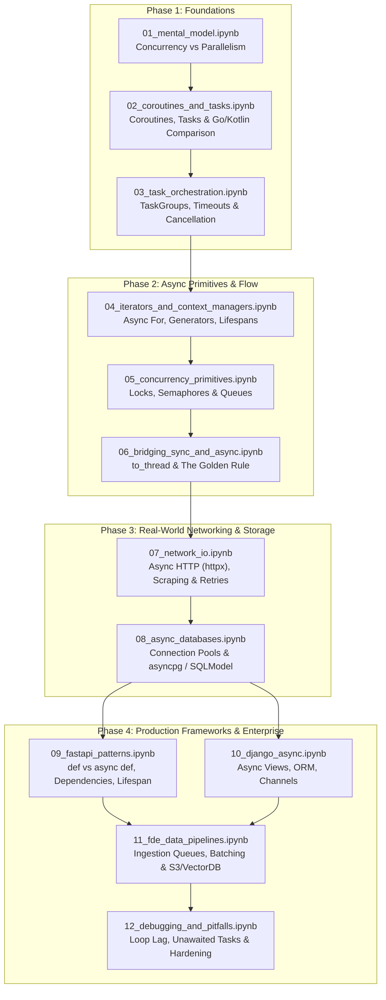

# 🚀 Async Python: From Zero to Production Mastery (Notebook Curriculum)

An interactive, notebook-first curriculum taking you from foundational mental models to production-grade asynchronous architecture in **FastAPI**, **Django**, and **Forward Deployed Engineering (FDE) / Data Pipelines**.

All 12 modules are fully generated as **Jupyter Notebooks (`.ipynb`)** with explanations, code examples, and pre-rendered preview outputs.

---

## 🗺️ Master Curriculum Roadmap

---

## 📚 Complete Notebook Curriculum

| # | Notebook | Status | Core Concepts & Applications |
|---|---|---|---|
| **01** | [`01_mental_model.ipynb`](./01_mental_model.ipynb) | ✅ **Ready** | CPU vs I/O-bound, Cooperative Multitasking, Synchronous vs Async timing benchmarks, Dependent tasks & pipelining |
| **02** | [`02_coroutines_and_tasks.ipynb`](./02_coroutines_and_tasks.ipynb) | ✅ **Ready** | Coroutines under the hood, `asyncio.create_task()`, Go vs Kotlin vs Python comparison, GC traps, Task cancellation |
| **03** | [`03_task_orchestration.ipynb`](./03_task_orchestration.ipynb) | ✅ **Ready** | `asyncio.TaskGroup` (Python 3.11+ Structured Concurrency), `ExceptionGroup` / `except*`, `asyncio.timeout`, `asyncio.shield` |
| **04** | [`04_iterators_and_context_managers.ipynb`](./04_iterators_and_context_managers.ipynb) | ✅ **Ready** | `async with` / `@asynccontextmanager`, `async for`, Async Generators for streaming large paginated API payloads |
| **05** | [`05_concurrency_primitives.ipynb`](./05_concurrency_primitives.ipynb) | ✅ **Ready** | Race condition prevention with `asyncio.Lock`, Rate limiting with `asyncio.Semaphore`, Producer-Consumer `asyncio.Queue` |
| **06** | [`06_bridging_sync_and_async.ipynb`](./06_bridging_sync_and_async.ipynb) | ✅ **Ready** | The Golden Rule: running blocking Pandas / Boto3 / PIL safely with `asyncio.to_thread` without freezing the loop |
| **07** | [`07_network_io.ipynb`](./07_network_io.ipynb) | ✅ **Ready** | High-throughput HTTP with `httpx.AsyncClient`, connection pool reuse, streaming payloads, exponential backoff retries |
| **08** | [`08_async_databases.ipynb`](./08_async_databases.ipynb) | ✅ **Ready** | Connection pooling (`min_size`, `max_size`), high-speed `asyncpg`, SQLModel / SQLAlchemy 2.0 Async, transaction rollbacks |
| **09** | [`09_fastapi_patterns.ipynb`](./09_fastapi_patterns.ipynb) | ✅ **Ready** | The `def` vs `async def` threadpool trap, async dependency injection (`Depends`), modern Lifespan context managers |
| **10** | [`10_django_async.ipynb`](./10_django_async.ipynb) | ✅ **Ready** | Django async views, async ORM queries (`aget`, `afirst`), `sync_to_async`, and Django Channels WebSockets |
| **11** | [`11_fde_data_pipelines.ipynb`](./11_fde_data_pipelines.ipynb) | ✅ **Ready** | Forward Deployed Engineering: Queue-backed multi-worker ingestion pipelines, micro-batching to Vector DB / S3, backpressure |
| **12** | [`12_debugging_and_pitfalls.ipynb`](./12_debugging_and_pitfalls.ipynb) | ✅ **Ready** | Event loop heartbeat lag monitoring, unawaited coroutine warnings, production readiness verification checklist |

---

## 💡 Quick Tips for Learning
- Every notebook includes **working code and pre-saved preview outputs**, so you can read and learn without needing to execute every cell first.
- When you want to run or tweak code, select the `.venv (Python 3.13.1)` kernel in the top-right corner of the notebook editor.
